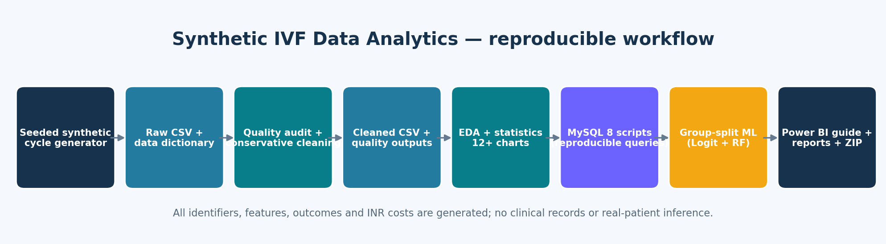
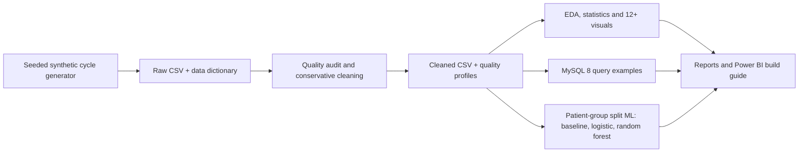

# Synthetic IVF Data Analytics & Embryo Outcome Prediction

  

> **Not clinical data, a clinical prediction tool, or medical advice.** Every record, identifier, measurement, outcome, and INR amount in this repository is generated synthetically from a documented fixed seed. Outcome rates and model scores describe only the simulation mechanism. They do not represent IVF patients, clinics, or real-world treatment efficacy.

## Overview

This portfolio project demonstrates a reproducible healthcare-style analytics workflow: synthetic data generation, data profiling, conservative cleaning, exploratory visualization, descriptive and association statistics, MySQL 8.0 query examples, patient-grouped exploratory classification, and a Power BI implementation guide. The dataset grain is one row per treatment cycle. Patients may have multiple cycles; embryo-grade and developmental-stage fields summarize a transfer candidate at cycle level and are **not embryo-level records**.

The generator creates about 3,000 cycles using NumPy seed `20260618`. It intentionally includes duplicate rows, malformed dates, missing measurements and outcome values, category inconsistencies, invalid ranges, and one impossible count relation to support quality-check practice.

## Problem statement and objectives

**Educational question:** Can a synthetic treatment-cycle table be generated, audited, summarized, queried, visualized, and used to demonstrate safe model-validation patterns without exposing real patient data?

Objectives:

- Generate a configurable synthetic cycle-level dataset and field dictionary.
- Profile missingness, types, duplicate rows, dates, ranges, logical count constraints and potential IQR flags.
- Clean invalid or inconsistent values without discarding statistically valid outliers.
- Explore synthetic distributions and simulated outcomes with 12+ charts.
- Compare descriptive outcome groups and appropriate association measures.
- Demonstrate leakage-aware Logistic Regression and Random Forest with a patient-level holdout.
- Provide executable MySQL query examples and a manual Power BI implementation specification.

## Architecture





## Dataset and data grain

- `data/synthetic_ivf_raw.csv`: 3,005 rows × 29 columns (3,000 generated cycle records plus five intentional duplicate rows).
- `data/synthetic_ivf_cleaned.csv`: 2,998 cycles after deduplicating and excluding two records with malformed dates.
- `data/synthetic_ivf_data_dictionary.csv`: field names, types, meanings and notes.
- 2,100 synthetic patient IDs; a patient may contribute repeated cycles.
- Date span: 2022-01-01 through 2025-12-30 after cleaning.
- Variables include simulated age, infertility duration, BMI, factor, AFC, AMH, stimulation protocol/duration, hormones, oocyte/fertilization/embryo cycle counts, cycle-level transfer grade/stage, endometrium, transfer count, simulated outcomes and synthetic INR cost.

The generator uses explicit pedagogical assumptions, including an illustrative logistic probability for clinical pregnancy and conditional draws for biochemical pregnancy and live birth. It is not clinically calibrated. Unknown outcome values and no-transfer cycles are kept null and treated separately. See [`data/README.md`](data/README.md), [`docs/methodology.md`](docs/methodology.md), and [`docs/limitations_and_ethics.md`](docs/limitations_and_ethics.md).

## Executed sample results

Results below were generated by the included code with seed `20260618`:

| Indicator | Executed synthetic result | Denominator / meaning |
|---|---:|---|
| Raw rows | 3,005 | Includes five intentional duplicates |
| Cleaned cycles | 2,998 | One row per cycle after cleaning |
| Fictional patients | 2,100 | Repeated cycles are grouped by patient ID |
| Transfer cycles | 2,910 | Cycles with one or more simulated transfers |
| Known clinical outcomes | 2,876 | 34 transfer outcomes remain unknown |
| Simulated clinical positives | 1,364 (47.4%) | Known clinical outcomes among transfer cycles |
| Grade A / B / C simulated positive proportions | 56.4% / 46.2% / 37.2% | n=876 / 1,404 / 596 known outcomes |
| Simulated mean cycle cost | ₹179,660 | Cost is arbitrary generated INR, not a real estimate |

Grade/outcome chi-square: χ²(2)=53.92, p≈1.96×10⁻¹², Cramér's V=0.137. Age/outcome Spearman ρ=−0.153; AMH/outcome ρ=0.096. These associations reflect a designed generator and are **not clinical findings**. Full tables, p-values, denominators and caveats are in `outputs/` and `reports/`.

### Exploratory model comparison — synthetic held-out patients

| Model | Accuracy | Precision | Recall | F1 | ROC-AUC |
|---|---:|---:|---:|---:|---:|
| Dummy prior baseline | 0.527 | 0.000 | 0.000 | 0.000 | 0.500 |
| Logistic Regression | 0.598 | 0.570 | 0.609 | 0.589 | 0.641 |
| Random Forest | 0.603 | 0.577 | 0.599 | 0.588 | 0.612 |

The split is by synthetic patient, with zero patient overlap between training and test. IDs and secondary outcome fields are excluded from features. Metrics only evaluate recovery of the simulator's patterns; they do not validate real-world clinical prediction and must never guide treatment.

## Repository structure

```text
synthetic-ivf-data-analytics/
├── README.md
├── LICENSE
├── requirements.txt
├── .gitignore
├── data/
│   ├── README.md
│   ├── synthetic_ivf_raw.csv
│   ├── synthetic_ivf_cleaned.csv
│   └── synthetic_ivf_data_dictionary.csv
├── notebooks/
│   ├── 01_synthetic_data_generation.ipynb
│   ├── 02_data_quality_and_cleaning.ipynb
│   ├── 03_exploratory_data_analysis.ipynb
│   ├── 04_statistical_analysis.ipynb
│   └── 05_machine_learning.ipynb
├── sql/
│   ├── 01_data_quality_checks.sql
│   ├── 02_ivf_business_analysis.sql
│   └── 03_outcome_analysis.sql
├── powerbi/
│   ├── dashboard_requirements.md
│   └── dashboard_screenshots/README.md
├── reports/
│   ├── executive_summary.md
│   ├── data_quality_report.md
│   └── business_insights.md
├── visuals/                 # 12 EDA plots, model plots, architecture PNG
├── outputs/                 # quality profiles, metrics, rates, cost tables, model outputs
├── src/                     # generation, cleaning, EDA, model scripts
└── docs/
    ├── methodology.md
    ├── data_dictionary.md
    └── limitations_and_ethics.md
```

## Tools

Python, NumPy, pandas, SciPy, Matplotlib, Seaborn, scikit-learn, Jupyter, MySQL 8.0-compatible SQL scripts, and Power BI build documentation. No `.pbix` file or genuine dashboard screenshot is included: Power BI Desktop is not available for authoring/verification here. The SQL scripts were authored to match the CSV schema but were not executed against a MySQL server in this environment.

## Installation and execution

Recommended: Python 3.10 or 3.11.

```bash
python -m venv .venv
# macOS/Linux
source .venv/bin/activate
# Windows PowerShell
.venv\Scripts\Activate.ps1
python -m pip install -r requirements.txt
```

Run the full workflow from the repository root, in order:

```bash
python -m src.generate_data --n-cycles 3000 --seed 20260618
python -m src.analysis
python -m src.modeling
python -m src.validate_project
```

Then open Jupyter and execute notebooks `01` through `05` in numerical order:

```bash
jupyter lab
```

The analysis writes cleaned/raw quality profiles, statistical tables, outcome summaries, model metrics, confusion matrices, ROC curves, feature importances, and PNG plots. The notebooks were executed successfully in this environment; see the validation checklist in the submitted project summary.

## MySQL 8.0 instructions

1. Start MySQL 8.0 and open `sql/01_data_quality_checks.sql` in MySQL Workbench.
2. Create/select the `synthetic_ivf_demo` database and run the table DDL.
3. Use **Table Data Import Wizard** to import `synthetic_ivf_raw.csv` into `ivf_cycles_raw` and `synthetic_ivf_cleaned.csv` into `ivf_cycles_cleaned`. Match columns by name and preserve empty fields as SQL `NULL`. In the raw table, `cycle_date` is text so malformed values remain auditable. In cleaned data, it is a DATE.
4. Run quality checks in script 01, business summaries in script 02, and outcome summaries in script 03. Script 03's raw-vs-clean comparison requires both tables imported.
5. Verify that known-outcome denominators match the CSV outputs. Null outcomes must not be counted as negative.

No SQL query execution is claimed because a MySQL server was not available for validation.

## Power BI setup

Open `powerbi/dashboard_requirements.md` for four-page design, data model, suggested DAX measures, field typing, slicers, visual QA and explicit synthetic labels. The `.pbix` and screenshots are **pending manual construction** in Power BI Desktop. The screenshots folder contains only a note; no fake image is supplied.

## Limitations and ethics

All outcomes, costs, IDs and clinical-like measures are fabricated. The simulation is not a patient cohort and has no clinical validity. Cycle-level rows are not embryo rows. Outcome unknowns are missing, not negatives. The grouped holdout prevents patient overlap but is not external clinical validation. P-values, accuracy and feature importance are descriptive of the synthetic generator. No clinical decisions, treatment recommendations, savings, or real success rates can be derived. Read [`docs/limitations_and_ethics.md`](docs/limitations_and_ethics.md) before sharing.

## Future improvements

Add unit tests and sensitivity runs across seeds; make outcome simulation parameters configurable; compare multiple patient-group split seeds; add calibration and subgroup metric demonstrations while retaining the synthetic disclaimer; manually build/validate a PBIX only if Power BI is available; and obtain clinical/ethics/privacy review before any real healthcare data project.

## Author

**Name:** `[Your Name]`  
**LinkedIn:** `[Your LinkedIn URL]`  
**Portfolio note:** All data and outcomes are synthetic and are presented only as a data-engineering/analytics exercise.

## License

The repository license applies to the original project code and documentation. The data are synthetic and generated by this repository. See [`LICENSE`](LICENSE). No real patient data or third-party clinical dataset is included.
